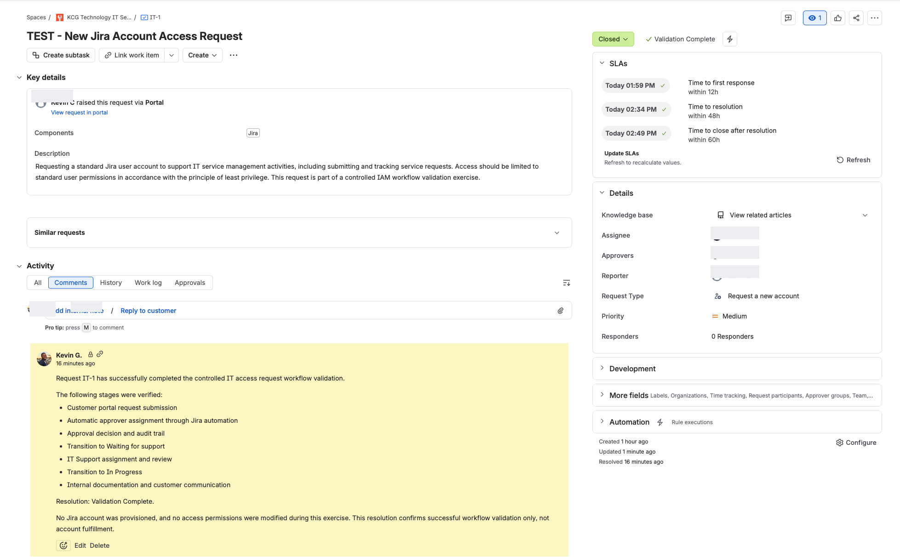
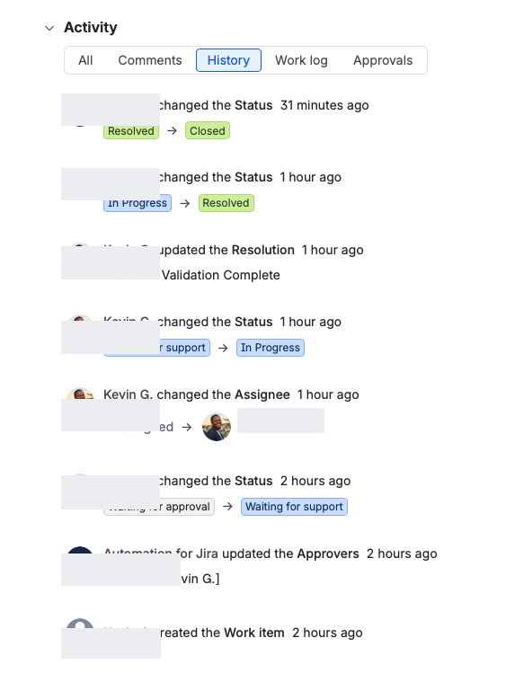
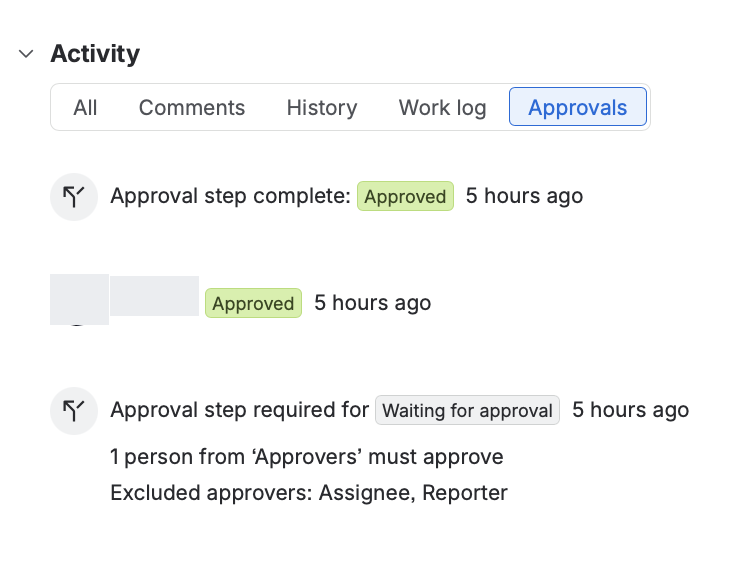

# IT-1: Jira Account Access Request Workflow Validation

## Lab Overview

**Platform:** Jira Service Management  
**Project:** KCG Technology IT Service Desk  
**Work Item:** IT-1  
**Request Type:** Request a new account  
**Final Status:** Closed  
**Resolution:** Validation Complete  

## Objective

Validate the end-to-end lifecycle of an IT account access request using Jira Service Management, including request submission, automated approver assignment, approval processing, IT Support handoff, workflow transitions, customer communication, and resolution tracking.

## Scope

This exercise focused on validating the service request management workflow and its supporting approval and audit mechanisms.

The exercise did not include actual Jira account provisioning, modification of user permissions, or production access changes.

## Validation Outcome

**Result: Successful**

The test request progressed through the following stages:

1. Waiting for approval
2. Waiting for support
3. In Progress
4. Resolved
5. Closed

The final resolution was recorded as **Validation Complete**.

Jira's activity history and approval records provided evidence of the workflow transitions and approval decision.

## Workflow Validation Steps

### 1. Customer Portal Request Submission

Submitted a test request through the Jira Service Management customer portal using the "Request a new account" request type.

The request specified standard Jira user access and emphasized the principle of least privilege.

**Validation:** Request IT-1 was created successfully and entered the approval workflow.

### 2. Automated Approver Assignment

Verified that Jira automation populated the Approvers field with the designated approver.

**Validation:** The work item history recorded the automated approver assignment.

### 3. Approval Processing

Reviewed and approved the request using the designated approver account.

**Validation:** The Approvals activity displayed the approved decision and completed approval step.

### 4. IT Support Handoff

Following approval, the request transitioned from Waiting for approval to Waiting for support.

The request was manually assigned to the IT Support agent.

**Validation:** The work item history recorded both the status transition and assignee change.

### 5. Support Investigation

Transitioned the request from Waiting for support to In Progress.

Added an internal note documenting the controlled validation exercise and its limitations.

**Validation:** The request entered In Progress and the internal note was recorded.

### 6. Customer Communication

Published a customer-visible response acknowledging approval and the IT Support handoff.

**Validation:** The response appeared in the customer portal activity.

### 7. Resolution and Closure

Resolved the request using the custom resolution "Validation Complete."

Subsequently transitioned the request from Resolved to Closed.

**Validation:** Jira recorded the final status transitions and resolution value.

No account provisioning or access permission changes were performed.

## SLA Validation Results

Jira Service Management tracked three service-level agreement (SLA) metrics during the controlled request lifecycle.

| SLA Metric | Recorded Time | Target | Result |
|---|---|---|---|
| Time to first response | 1:59 PM | Within 12 hours | Met |
| Time to resolution | 2:34 PM | Within 48 hours | Met |
| Time to close after resolution | 2:49 PM | Within 60 hours | Met |

### Observations

- All three SLA metrics displayed successful completion indicators.
- The first-response SLA was satisfied following customer-visible communication.
- The resolution SLA was satisfied when the request reached Resolved.
- The closure SLA was satisfied when the request transitioned to Closed.
- The Jira interface recorded each milestone for review.

### Validation Conclusion

The SLA configuration successfully tracked response, resolution, and closure milestones during the test.

These results validate SLA tracking for request IT-1 only. They do not establish broader service desk performance or production SLA compliance.

## Evidence and Supporting Documentation

The following screenshots document the controlled Jira Service Management workflow validation for request IT-1.

### Evidence 01: Final Request Status and SLA Results

**Evidence:** Displays the Closed status, Validation Complete resolution, assigned support agent, and three successfully completed SLA milestones.

### Evidence 02: Request Lifecycle History

**Evidence:** Documents workflow status transitions, automated approver assignment, manual support assignment, and resolution updates.

### Evidence 03: Approval Decision and Audit Trail

**Evidence:** Shows the completed approval step, approved decision, and approval workflow requirements.

### Evidence Limitations

These screenshots demonstrate Jira Service Management workflow behavior for one controlled test request.

They do not demonstrate actual account provisioning, permission modifications, or production access fulfillment.

